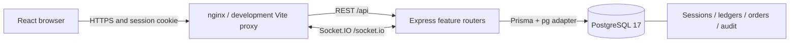

# Architecture and business rules

The Copper Table is a single-restaurant application organized as an npm workspace monorepo. Browser state comes from the API; PostgreSQL is authoritative for orders, money, stock and history. No financial or inventory records use browser localStorage as their source of truth.

| Location | Responsibility |
| --- | --- |
| `apps/web` | React, Vite, TypeScript, Tailwind, local shadcn-style primitives, role-aware React Router pages and TanStack Query |
| `apps/api` | Express feature routers, Zod validation, server sessions, authorization, transactions, reports and Socket.IO |
| `packages/shared` | Public Zod contracts and types shared between server/browser |
| `prisma` | Normalized schema, PostgreSQL constraints/triggers, reviewed migrations and development-only seed |
| `docs` | Domain policies, setup, verification and deployment instructions |

React Hook Form/Zod manage validated login input. Operational forms send decimal strings to the API. Recharts displays actual report data. The frontend query cache handles loading/errors and refreshes after successful writes and relevant socket events.

## Identity and security boundary

`express-session` stores a signed opaque session identifier in an HTTP-only, SameSite=Lax cookie. Session content is persisted by `connect-pg-simple` in PostgreSQL's `Session` table. Cookies are secure in production. Passwords use bcrypt cost 12; input limits respect bcrypt's 72-byte maximum. Login regenerates the session and is rate-limited; logout destroys it. Every protected request rechecks that the user is still active, and changing access/password invalidates existing sessions and connected sockets.

State-changing requests require JSON and the session-specific `x-csrf-token`. Browser Origin is checked when present. The frontend obtains the token through `/auth/me` and attaches it automatically. Role-based navigation improves usability; backend middleware enforces permission on each operation. Only owners administer users, write settings and inspect audit logs. Managers operate the restaurant and view reports; cashier, kitchen and inventory roles have narrower operational permissions.

Input validation, bounded bodies, security headers, redacted structured logs and centralized errors avoid exposing internal stack traces or secrets to clients. Database checks complement service validation. They do not replace authorization.

## Transactions, retries and history

Stock and financial commands run in serializable Prisma transactions with bounded retries for serialization/deadlock conflicts. Business mutation, audit entry, stock movement and idempotency result commit together. Idempotency keys are scoped by actor and operation; a reused key with a different payload returns a conflict. Payment/receipt commands have their own scopes, so retries cannot create another charge record or delivery.

Money is PostgreSQL `Decimal(14,2)`; quantities/unit costs are `Decimal(18,6)`. Rates are six-place fractions in `[0,1]`. Inputs/JSON use decimal strings, and the server calculates totals with decimal arithmetic and currency rounding. Order lines snapshot menu label, unit price, estimated unit cost and recipe version. Later menu edits cannot rewrite an old receipt or cost estimate.

Inventory movements, audit logs, payments, receipt records and recipe versions/ingredients are append-only at the database level. Referenced operational history uses restrictive foreign keys. Corrections create refunds or compensating stock records; catalog/users are deactivated instead of deleting referenced history. See [database decisions](database.md) for the schema and constraints.

## Stock and order lifecycle

1. Each ingredient has a canonical storage unit: `G`, `ML` or `PIECE`. Input `KG` converts to grams, and `L` to millilitres. Incompatible dimensions are rejected.
2. Available quantity is `onHand - reserved`. A pending order snapshots its recipes/prices but holds no stock.
3. Confirmation aggregates recipe quantities across the entire order and reserves every required ingredient in one transaction. Any shortage rolls back the complete command. Concurrent orders cannot spend the same availability.
4. Entering `PREPARING` converts active reservations to consumption movements once and reduces both balances. Repeating the command cannot consume again.
5. Cancelling pending/confirmed orders releases active reservations. An owner/manager can cancel after preparation, but physically consumed stock remains consumed. A separate documented correction is needed for genuine recoverable stock.
6. The kitchen records prepared item quantities. All items must be prepared before `READY`; completion requires ready status and full recorded payment. The API rejects unauthorized or out-of-order transitions.

The normal path is `PENDING → CONFIRMED → PREPARING → READY → COMPLETED`, with validated cancellation paths. Cashiers create/pay orders and have limited completion/cancellation rights; kitchen staff progress preparation. Refunds require owner/manager access and cannot exceed net captured payment. Payment methods come from restaurant settings. Payment entries record what staff say was collected/refunded; the application does not process bank/card payments.

PostgreSQL prevents negative on-hand stock and over-reservation. Deferred triggers additionally require every cached balance to equal its ledger and every reserved balance to equal active reservations at commit. A standalone balance edit cannot commit. Every movement has a reason, timestamp and actor.

## Purchasing and approval policy

Purchases begin as draft estimates, become ordered, and can be partially or fully received. A receipt validates line ownership, canonical quantities, nonnegative actual unit cost and outstanding quantity. It updates received totals, weighted-average ingredient cost, stock balances and ledger entries together. A duplicate request returns its original receipt. Duplicate lines or over-receiving are rejected.

Cancel an open purchase to close its remaining quantity. Already received stock and receipts remain intact. Record only accepted goods; handle an excess shipment by a separate authorized purchase rather than silently expanding the original. Supplier returns and accounting credit notes are not automated; use an approved stock correction with a reason and retain supplier documents externally.

Waste, adjustments and counts are proposals until approved by an owner/manager. Approval records its actor/time and posts one ledger effect. Waste is valued at the current inventory cost when approved. A count stores its expected quantity and is rejected at approval if stock changed since its snapshot. Unchanged count lines need no zero-quantity movement. Only authorized adjustment/count movements support a single explicit compensating reversal.

Receipt lines can retain an expiry date, and the ingredient exposes an aggregate earliest recorded expiry for alerts. This is a reminder to inspect stock; no per-batch balance, lot traceability or automatic first-expiring-first-out allocation is implemented. Operators must manage physical batch rotation.

## Reporting definitions

All reports query persisted records. Inclusive business dates are converted using the configured IANA timezone to an exclusive UTC end boundary. The default timezone is `Asia/Karachi`; a browser's timezone never selects a different business day.

- **Sales:** cash-basis payment/refund events in the selected interval, excluding tax and including order discounts. Unpaid orders contribute no sales. Refund allocation uses the original order proportions.
- **Collected/refunds/tax:** gross positive payment records, separate positive refund totals, and net allocated tax. Sales plus tax reconcile with net captured cash.
- **Estimated COGS:** historical order recipe-cost snapshot allocated by the payment/refund fraction. A financial refund reverses this estimate proportionally; it does not reverse physical ingredients.
- **Estimated gross profit:** sales less estimated COGS. Rent, wages and other operating expenses are absent, so this is not net profit.
- **Order count/AOV:** distinct orders with positive payment in the interval; average order value is net sales divided by that count. A refund-only interval can therefore show negative sales with no paid-order count.
- **Consumption:** actual immutable preparation movements, including food prepared for orders later cancelled. Costs use the movement snapshot.
- **Valuation:** current on-hand stock times current weighted-average cost. Date filters do not reconstruct historical balances. Low-stock/open-purchase dashboard counts are current snapshots too.

CSV exports preserve decimal text, quote fields and escape spreadsheet formula prefixes. Report JSON is paginated; CSV exports contain the selected report rows. The current implementation aggregates within the API for a bounded date range; large multi-year/high-volume installations need database aggregate/streaming work before scaling.

Reorder estimates average recorded consumption across the last 30 calendar days and target the greater of minimum stock or seven days of demand. At least three distinct consumption dates are required; otherwise the response explicitly says `INSUFFICIENT_HISTORY` and only replenishes minimum stock. These are explainable rule-based estimates, without an AI service.

## Realtime and operational messages

Socket.IO authenticates the persistent session and joins only the user's role/user rooms. Events publish after transactions commit. Clients perform an initial authoritative fetch and refetch on connection/reconnection and relevant events; missed or duplicate events do not run business mutations. API reads remain the source of truth.

New/ready orders, low stock and purchases produce role-scoped notifications. Periodic checks add delivery-due and recorded-expiry reminders without repeatedly duplicating the same daily message. Read markers are per user; the API filters message audiences and prevents access to another audience's notification. Sensitive operations write immutable audit entries without password/session values.

The supplied deployment is one API instance. Horizontal scaling needs a supported Socket.IO adapter/shared delivery strategy and an appropriate session/load-balancer design. See [deployment](deployment.md) for container routing, release jobs and operational ownership.
